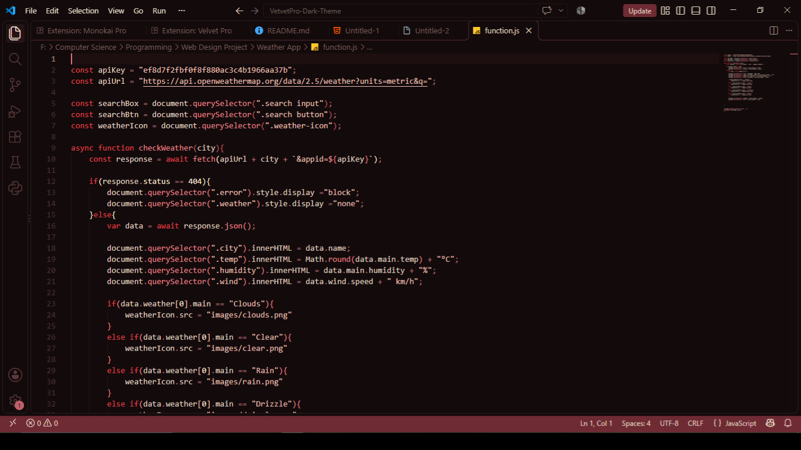
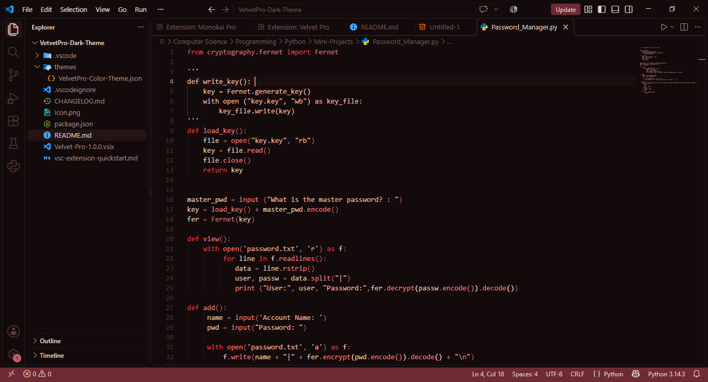

<<<<<<< HEAD
# Velvet Pro - Visual Studio Code

A refined, warm-dark theme for Visual Studio Code featuring deep charcoal tones and subtle crimson accents, optimized for long, comfortable coding sessions. The single goal of Velvet Pro is to let you focus on your code.

## Preview

JavsScript

Python

## Highlights

* **Deep Charcoal Background:** Reduces eye strain during long coding sessions.
* **Warm Crimson Accents:** High-contrast functional highlights for keywords and active elements.
* **Clean UI:** Seamless integration across the title bar, editor tabs, and sidebar.

## Installation

1. Open **Extensions** in VS Code (`Ctrl+Shift+X`).
2. Search for `Velvet Pro`.
3. Click **Install** and select `Velvet Pro` as your Color Theme.
=======
# Velvet-Pro README

## Working with Markdown

You can author your README using Visual Studio Code. Here are some useful editor keyboard shortcuts:

* Split the editor (`Cmd+\` on macOS or `Ctrl+\` on Windows and Linux).
* Toggle preview (`Shift+Cmd+V` on macOS or `Shift+Ctrl+V` on Windows and Linux).
* Press `Ctrl+Space` (Windows, Linux, macOS) to see a list of Markdown snippets.

## For more information

* [Visual Studio Code's Markdown Support](http://code.visualstudio.com/docs/languages/markdown)
* [Markdown Syntax Reference](https://help.github.com/articles/markdown-basics/)

**Enjoy!**
>>>>>>> ce00995f14b48fe87c91f6f35afdd4eb881e6c59
